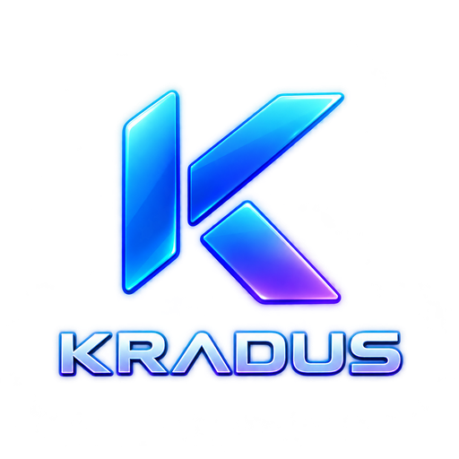

# Kradus Media — MP3 Pleyer (Android)




Oddiy boshqaruv. Tartibli kutubxona. **Barcha musiqa va sozlamalar faqat qurilmada qoladi** — hech qayerpa yuklanmaydi va kuzatilmaydi.

> **English summary:** Kradus Media is a fully native Android MP3 player (Kotlin + Jetpack Compose + ExoPlayer + NDK C++). Local library with folders, favorites, search, streaming URL tracks, background playback with lock-screen controls. No accounts, no ads, no tracking — everything stays on the device. Build instructions below work the same in English; commands need no translation.

## Mundarija

- [Xususiyatlar](#xususiyatlar)
- [Ekranlar](#ekranlar)
- [Texnologiyalar](#texnologiyalar)
- [Tezlik sirlari (optimallashtirish)](#tezlik-sirlari-optimallashtirish)
- [Loyihani yig‘ish](#loyihani-yigish)
- [Testlar](#testlar)
- [Maxfiylik va ruxsatlar](#maxfiylik-va-ruxsatlar)
- [Loyiha tuzilishi](#loyiha-tuzilishi)
- [Muallif](#muallif)
- [Litsenziya](#litsenziya)

## Xususiyatlar

- 🎵 **Mahalliy MP3** — tizim tanlash oynasi orqali qo‘shish (nusxa ilovaning yopiq xotirasida saqlanadi)
- 🔍 **Telefon skaneri** — MediaStore orqali barcha musiqani ablojkasi bilan bir martalik import; indekslanmagan papkalar uchun C++ skaner (ixtiyoriy «Barcha fayllar» ruxsati bilan)
- 🌐 **Havola orqali** — `http(s)` MP3 manzillar (striming, yuklab olinmaydi), avtomatik «Internetdan qo‘shilganlar» papkasi
- 📁 **Papkalar** — yaratish, nomlash, o‘chirish, treklarni ko‘chirish
- ❤️ **Sevimlilar**, 🔎 jonli qidiruv (nom/ijrochi/albom/papka), 150 ms kechikish bilan fonda filtr
- ▶️ **Ijro** — ExoPlayer: pauza/davom, oldingi/keyingi, 0–100% ovoz, 0.5×–2× tezlik, takrorlash (bitta/navbat), aralash ijro
- 🔔 **Fonda ijro** — media-sessiya servisi: bildirishnoma va bloklangan ekrandan boshqaruv
- 🖼️ **Ablojkalar** — MediaStore art + MP3 ichidagi rasm, LRU kesh, namoyish o‘lchamida dekodlash
- 👆 **Kutish rejimidan keyin ham** — holat (trek, navbat, ovoz, tezlik) saqlanib qoladi

## Ekranlar

| Tinglash | Kutubxona | Pleyer |
|---|---|---|
| Katta ablojka, progress, boshqaruv, ovoz, statistika, so‘nggi treklar | Qidiruv, papka chiplari, import tugmalari, skaner, treklar ro‘yxati | To‘liq ekran ijro, tezlik tanlash |

Qo‘shimcha: **Papkalar** (kartalar + papka ichi ko‘rinishi), **Sevimlilar**, **Ilova haqida** (muallif havolasi bilan) muloqotlari.

> Skrinshotlar `screenshots/` papkasiga qo‘shiladi.

## Texnologiyalar

| Qatlam | Nima |
|---|---|
| Til | Kotlin (JVM 17) |
| UI | Jetpack Compose (Material3, Navigation) |
| Audio | ExoPlayer + Media3 Session (foreground service) |
| Tez yo‘llar | NDK C++17 (`-O3`): JSON normallashtirish, bulk dedupe, rekursiv MP3 skaner |
| JSON | Gson (saqlash formati: schema v2) |
| Concurrency | Kotlin Coroutines/Flow (`Dispatchers.IO/Default`, 450 ms debounce) |

**Qo‘llab-quvvatlash:** Android 7.0+ (minSdk 24), `arm64-v8a` / `armeabi-v7a` / `x86_64` (bitta APK — telefon, planshet, Chromebook, emulyator).

## Tezlik sirlari (optimallashtirish)

Zaif telefonlarda 30 000+ trek bilan ham ravon ishlashi uchun:

- **C++ single-pass normallashtirish** — saqlangan hujjatni bir o‘qishda tahlil + validatsiya + migratsiya (30 ming trek ≈ 0,2–0,3 soniya)
- **Tipli tahlil** — native chiqish `Map<String, Any?>` daraxtisiz o‘qiladi (yuzlab MB vaqtincha xotira tejaladi)
- **Og‘ir ish fonda** — yuklash/tahlil/saqlash `Dispatchers.IO` da; qidiruv/filtr `Dispatchers.Default` da (UI hech qachon qotmaydi)
- **Bitta yozuv qoidasi** — bulk importda bitta holat yangilanishi + bitta kechiktirilgan disk yozuvi
- **1 soniyalik polling** (ijro holati), kalitli `LazyColumn`, 150 ms qidiruv kechikishi
- **Ablojka byudjeti** — 128/512 ikki o‘lcham, 48 yozuvli LRU

## Loyihani yig‘ish

Talablar: **JDK 17**, Android SDK (platform 34, build-tools 34), **NDK 27** + CMake 3.22 (Android Studio o‘zi o‘rnatadi).

```bash
cd android-native

# Debug APK + unit testlar (Windows cmd):
gradlew.bat --no-daemon :app:assembleDebug :app:testDebugUnitTest

# Natija: app/build/outputs/apk/debug/app-debug.apk
```

Android Studio’da ochish: `android-native/` papkasini oching — Gradle sync’dan keyin ▶️ **Run**.

Qurilmaga o‘rnatish (USB debugging yoqilgan bo‘lsin):

```bash
"D:\Android\Sdk\platform-tools\adb.exe" install -r android-native\app\build\outputs\apk\debug\app-debug.apk
```

C++ paritet testi (qurilmasiz, faqat `g++` kerak):

```bash
g++ -std=c++17 -O2 <test-harness> -o kradus_native_test && ./kradus_native_test
# 56 ta test: normallashtirish, dedupe, URL/emoji/escape qoidalari, 30k stress, chuqurlik limiti, skaner
```

## Testlar

- **JVM unit testlar** (`app/src/test`): `LibraryModelTest` (9 ta — saqlash/migratsiya qoidalari), `NativeSnapshotParseTest` (5 ta — tipli native tahlil, jumladan emoji) — jami **14/14 yashil**
- **C++ parity harness**: real `kradus_core.h` ni `g++` bilan yig‘ib, 30 ming trekli stress + chekka holatlarni tekshiradi — **56/56 yashil**

## Maxfiylik va ruxsatlar

| Ruxsat | Nima uchun | Qachon so‘raladi |
|---|---|---|
| `POST_NOTIFICATIONS` | Ijro bildirishnomasi | Faqat ijro boshlangandan keyin (bir marta) |
| `READ_MEDIA_AUDIO` / `READ_EXTERNAL_STORAGE` (≤32) | Telefon musiqasini skanerlash | Faqat «Skanerlash» tugmasida |
| `MANAGE_EXTERNAL_STORAGE` | Indekslanmagan MP3’larni topish (ixtiyoriy) | Faqat foydalanuvchi Sozlamalarni o‘zi ochganda |
| `INTERNET` | URL treklarni oqimli ijro etish | Hech qachon kuzatuv/tahlil uchun emas |
| `FOREGROUND_SERVICE` + `MEDIA_PLAYBACK` | Fonda ijro | Ijro paytida |

**Kafolatlar:** hisob yo‘q, reklama yo‘q, tahlil (analytics) yo‘q, treklar/faollar hech qayerpa yuborilmaydi. Mikrafon/kamera/geolokatsiya umuman so‘ralmaydi. URL manzil login-parol/token saqlasa rad etiladi.

## Loyiha tuzilishi

```
android-native/
├── app/src/main/cpp/            # kradus_core.h (umumiy dvijok) + thin JNI
├── app/src/main/java/.../music/ # Models, LibraryStore, MusicViewModel,
│                                #   PlayerHolder, KradusPlayerService,
│                                #   MediaStore/DeviceFileScanner, ArtworkCache
├── app/src/main/java/.../ui/    # 5 ekran + dialoglar + komponentlar + tema
├── app/src/main/res/            # logo, ranglar, mavzu
└── app/src/test/                # JVM unit testlar
plan.md / TODO.md                # mahsulot qoidalari (o‘zbekcha)
```

## Muallif

**@machine_dev** — https://t.me/machine_dev

## Litsenziya

MIT — batafsil `LICENSE` faylida.
